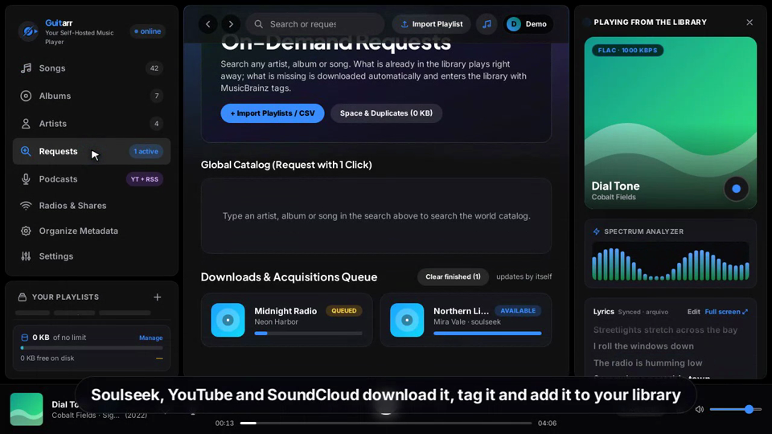

# Guitarr

**Guitarr** is a self-hosted, vibe-coded music server with on-demand acquisition: search a world catalog
(MusicBrainz), press **Request**, and the album or track is downloaded, tagged and shows up in
your library, ready to stream on the web, on the phone (PWA / Android app) or in any Subsonic client.

> The web UI and the phone app come in **English** (default) and **Portuguese (BR)**. Switch the language
> in the account menu, in Settings or on the first step of the tour. A Portuguese install guide is in
> [`LEIA-ME.md`](LEIA-ME.md).

[](docs/guitarr-intro.mp4)

*Click the picture to watch the 1-minute intro (web UI and phone app, fictional demo data).*

## Contents

1. [What you get](#what-you-get)
2. [Requirements](#requirements)
3. [Install, step by step](#install-step-by-step)
4. [First login and setup](#first-login-and-setup)
5. [Using Guitarr](#using-guitarr)
6. [Reach it from outside your home](#reach-it-from-outside-your-home)
7. [Phone and desktop apps](#phone-and-desktop-apps)
8. [Updating and backups](#updating-and-backups)
9. [Configuration reference](#configuration-reference)
10. [Troubleshooting](#troubleshooting)
11. [Development](#development)
12. [Built on](#built-on) / [Legal](#legal)

## What you get

- **Requests** (`/api/seer/*`): catalog search, request queue with status, admin approval, retry that
  goes another way (failed sources last, other search phrasing, other uploads/peers). Searching from the top
  bar shows your library first and the MusicBrainz catalog right below it, so you can request what is missing.
- **Sources** tried in order: Soulseek (slskd), YouTube Music / YouTube and SoundCloud (yt-dlp), Lidarr.
  Albums can be built track by track when no source has the whole album.
- **Consistent tags**: downloads are retagged with MusicBrainz names and ids (album, release group, artist),
  so near-duplicate albums and artists stop appearing.
- **Metadata organizer**: finds albums and artists that differ only by case, accents or punctuation,
  merges them, matches albums to MusicBrainz and fixes missing covers.
- **Library tools**: duplicate finder and cleaner, storage limit, tag editor, other versions of a song
  (live, acoustic, remaster), delete from disk.
- **SmartRadio and Daylist** on the Home page: endless mixes made from what you like and play.
- **Lyrics** (synced or plain) from LRCLIB, saved next to the audio files, with an editor.
- **Podcasts** (RSS and YouTube channels) with retention policies, **web radio** with a station
  directory search, and a **liked songs** playlist.
- Playlist and liked-songs import from Spotify / YouTube Music links or CSV exports (Exportify and similar).
- **Web UI** served at `/app/` (single HTML file generated by `ui/build.py`), a **mobile PWA** and an
  **Android app** with offline music.

## Requirements

- A Linux machine (a home server, a NAS, a Raspberry Pi 4+ or a VPS). macOS and Windows with WSL2 also work
  for trying it out, but `setup.sh` was written for Linux.
- **Docker Engine 24+** and **Docker Compose v2** (`docker compose version` must work).
- `git`, `sudo` and `openssl` (or any POSIX shell tools) for the setup script.
- About **5 GB** free for the first image build, plus space for your music.
- Optional but recommended: a free **Soulseek** account (the setup script creates it on first login) and a
  place to keep your music files.
- Free ports on the machine: **4533** (Guitarr), **5030** (slskd web panel, keep it on your local
  network) and **50300** (Soulseek).

## Install, step by step

**1. Get the code**

```bash
git clone https://github.com/guivalli/guitarr.git
cd guitarr
```

**2. Choose where the files live** (skip this to use `./data` and `./music` inside the project)

```bash
cp .env.example .env
nano .env
```

Uncomment and edit what you need. The most useful ones:

```bash
GUITARR_DATA=/srv/guitarr          # database, slskd and downloads
MUSIC_DIR=/srv/music               # your music library (existing files are fine)
PUBLIC_URL=https://guitarr.example.com
TZ=America/Sao_Paulo
```

The `.env` file never goes to git and holds **no secrets**; passwords are set in the web UI.

**3. Run the setup script (do not skip it)**

```bash
./setup.sh
```

It creates the folders with the right owner (it asks for your `sudo` password once), asks for your
**Soulseek username and password** and the password of the slskd web panel, and writes `slskd.yml` with a
fresh API key. If you run `docker compose up` before this, Docker creates `slskd.yml` as an empty
*folder* and the stack will not start: delete it and run the script.

Pick a Soulseek username nobody uses yet: the account is created the first time slskd logs in.

**4. Build and start**

```bash
docker compose up -d --build
```

The first build downloads Navidrome at a pinned commit, applies the patches, builds the UI and compiles the
server. It takes a few minutes. When it finishes, check:

```bash
docker compose ps                                            # guitarr and slskd should be "Up (healthy)"
docker compose logs slskd | grep -i -E "logged in|invalid"   # Soulseek login worked?
docker compose logs -f guitarr                               # requests and downloads
```

**5. Open it**

Go to `http://localhost:4533` (or `http://SERVER-IP:4533` from another device). The page redirects to the
new web UI at `/app/`.

## First login and setup

1. **Create your admin account.** The **first user** that opens Guitarr becomes the admin, so do this
   on your home network *before* exposing the server to the internet.
2. A short **tour** shows the main features. Pick your language on its first step.
3. Open **Settings** (account menu, top right) and check:
   - **Approve requests automatically**: on = every request goes straight to the download queue; off =
     an admin approves each one.
   - **Download sources** and their order (`soulseek,youtube,soundcloud` by default). Enable Lidarr only
     if you run it.
   - **Soulseek**: change the username, password or panel login here at any time (they are written to
     `slskd.yml` and slskd reconnects by itself).
   - **YouTube cookies** (optional): to import private lists such as "Liked songs".
   - **Spotify** client id and secret (optional): makes importing long playlists faster. Public playlists work without it.
   - **Minimum free disk space**: downloads pause below this (default 5 GB).
4. Put music in `MUSIC_DIR` if you already have some. Guitarr scans the folder on start and when it changes.
   Downloads land in `MUSIC_DIR/Seer/<Artist>/<Album>/`.
5. Add more people in **Settings → Users** (name, password, administrator or not); each user has their own favorites,
   playlists and settings.

## Using Guitarr

- **Search and request**: type in the top search bar. Library results come first; below them the MusicBrainz
  catalog shows what you do not have, each with a **+ Request** button. Open an artist to see the whole
  discography with the missing albums marked.
- **Requests** (sidebar): follow each request (pending, queued, searching, downloading, importing,
  available or failed). Admins approve pending ones; for a failed one use **Try again**, which takes another path.
- **Import playlists**: paste a Spotify or YouTube Music link, or upload a CSV/JSON/ZIP export (Exportify, TuneMyMusic,
  Soundiiz, Google Takeout). Tracks you already own are matched; the rest become requests.
- **Organize Metadata** (admin): analyze the library, merge duplicate albums and artists, apply MusicBrainz
  suggestions, fetch missing covers.
- **Storage** (bottom of the sidebar): see the space used, set a limit and clean duplicates.
- **Podcasts** and **Radios & Shares**: subscribe to RSS feeds or YouTube channels with a retention policy, search
  internet radio stations, create share links.
- **Edit tags, lyrics, other versions**: use the ⋮ menu of a track.
- **SmartRadio / Daylist** on the Home page start endless mixes built from your listening.

## Reach it from outside your home

Guitarr speaks plain HTTP on port 4533. To use it away from home, and to install the phone app, put **HTTPS**
in front of it. Two common ways:

- **Reverse proxy** on the same machine, for example Caddy (automatic certificates):

  ```
  guitarr.example.com {
      reverse_proxy localhost:4533
  }
  ```

- **A tunnel**: Cloudflare Tunnel, Tailscale Funnel or similar, pointing to `http://localhost:4533`.

Create your admin account first, then expose the server. Do **not** publish ports 5030 and 50300 to the internet
unless you know why; 5030 is the slskd admin panel.

## Phone and desktop apps

- **Install as an app (PWA)**: open your HTTPS address in Chrome (Android) or Safari (iOS) and use *Install
  app* / *Add to Home Screen*. On the desktop use Chrome, Edge or Brave. The mobile UI lives at `/app/mobile/`.
- **Android APK with offline music** (downloads with the screen off, lock-screen controls): build it with Docker,
  no Android Studio needed:

  ```bash
  cd apps/android
  ./build-apk.sh          # signed release -> dist/Guitarr-<version>-release.apk
  ```

  The first run creates a signing key in `apps/android/keystore/` (not in git). **Back it up**: without the
  same key Android refuses to update the installed app. Details in [`apps/android/README.md`](apps/android/README.md).
- **Linux desktop app**: `bash apps/instalar-linux.sh https://your-address` (see [`apps/LEIA-ME.md`](apps/LEIA-ME.md)).
- **Other clients**: Guitarr speaks the Subsonic API, so Symfonium, Tempo, Substreamer, DSub and similar
  apps can play your library too (they do not have the request screens).

## Updating and backups

```bash
git pull
docker compose up -d --build        # data and .env are untouched
```

YouTube changes often. If downloads from YouTube stop working, rebuild with a fresh `yt-dlp`:

```bash
docker compose build --no-cache guitarr && docker compose up -d
```

**Back up** the folder `GUITARR_DATA` (database, encryption key `seer.key`, slskd config) and your `.env`.
Without `GUITARR_DATA/guitarr/seer.key` the saved secrets become unreadable.

Useful commands: `docker compose down` (stop), `docker compose logs -f guitarr`, `docker compose ps`.

## Configuration reference

`.env` variables (all optional, see [`.env.example`](.env.example)):

| Variable | Default | What it does |
|---|---|---|
| `GUITARR_DATA` | `./data` | Database, slskd and downloads |
| `MUSIC_DIR` | `./music` | Music library (downloads go to `Seer/` inside it) |
| `PUBLIC_URL` | `https://guitarr.example.com` | Address sent in the User-Agent of catalog queries |
| `TZ` | `UTC` | Time zone |
| `PUID` / `PGID` | `1000` / `1000` | Owner of the files and of the containers' processes |
| `COMPOSE_PROJECT_NAME` | `guitarr` | Docker Compose project name |
| `YOUTUBE_COOKIES` | empty | Path (inside the container) of a `cookies.txt` for private YouTube lists |

Everything else (sources, Soulseek, Lidarr, Spotify, free-space minimum, auto-approve) is edited in **Settings**.
The full list of server options (`ND_SEER_*`) and the HTTP API is in [`docs/API.md`](docs/API.md).

## Troubleshooting

- **`slskd` keeps restarting or "is a directory"**: `slskd.yml` was created as a folder. Stop the stack,
  `rm -r "$GUITARR_DATA/slskd/slskd.yml"` and run `./setup.sh` again.
- **Soulseek says the password is invalid**: that username already belongs to someone else. Choose another in
  Settings.
- **Requests stay "searching" or fail**: look at `docker compose logs -f guitarr`. Try again from the request
  (it takes another source), check that slskd is `healthy` and that port 50300 is open on your router.
- **"MusicBrainz did not answer"**: the public MusicBrainz server is rate limited; wait a minute and retry.
- **Permission denied on the music folder**: set `PUID`/`PGID` in `.env` to the owner of `MUSIC_DIR` and run
  `./setup.sh` again.
- **The phone will not offer to install the app**: it needs HTTPS (see above).
- **Port 4533 is taken**: change the left side of `"4533:4533"` in `docker-compose.yml`.

## Development

- `ui/` holds the sources of the web UI: `guitarr.mock.html` (design), `live.js` (talks to the server),
  `build.py` (generates `guitarr.html`), `theme.js`, the language files `i18n.js`, `i18n-en.tsv` and
  `i18n-mobile.tsv`, and `mobile/` (the phone app, built by `ui/mobile/build_mobile.py`).
  Rebuild with `cd ui && python3 build.py guitarr.mock.html live.js ../guitarr.html && python3 mobile/build_mobile.py`.
  New texts in the UI are written in Portuguese and need a line in the `.tsv` for the English version.
- The server code lives only as a patch series in [`patches/`](patches) on top of a pinned upstream commit
  (`NAVIDROME_COMMIT` in the `Dockerfile`). To update: bump the commit, build, fix the patches that no longer apply.
- Smoke tests (`ui/tools/*smoke*.js`, `ui/mobile/smoke*.js`) run with `jsdom`. [`CLAUDE.md`](CLAUDE.md) has the
  maintainer notes (workflow, tests, pitfalls).
- Internal identifiers still say `seer` (`/api/seer/*`, `ND_SEER_*`, `core/seer`) to keep existing installs and
  clients working.

## Built on

- **[Navidrome](https://github.com/navidrome/navidrome)**: the music server. Guitarr is Navidrome at a
  pinned commit plus the patch series in [`patches/`](patches). All credit for the server goes to the
  Navidrome authors and contributors.
- **[Seerr](https://github.com/seerr-team/seerr)** (formerly Overseerr / Jellyseerr): the idea and the
  workflow of requests, approval and an automatic download queue come from it, brought here to music.
  No Seerr code is used.

Guitarr is not affiliated with, endorsed by or supported by either project.

## Legal

- Guitarr is released under the same license as Navidrome, **GPL-3.0** (see [`LICENSE`](LICENSE)). Navidrome is
  © its contributors; Guitarr keeps upstream's notices.
- Seerr, Overseerr and Jellyseerr are © their contributors; Guitarr only borrows the request workflow and the
  "-arr" naming tradition.
- You are responsible for what you download: use the acquisition features only for content you have the
  right to obtain.
